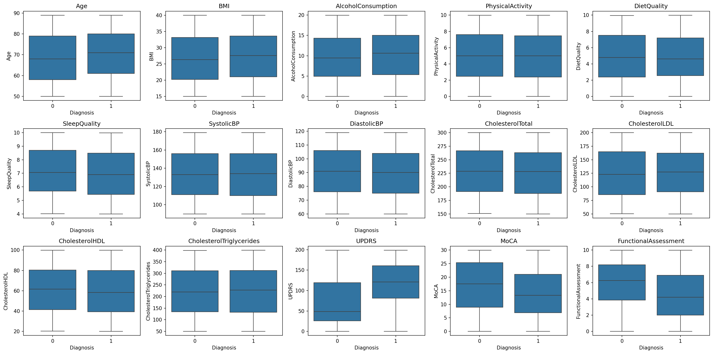
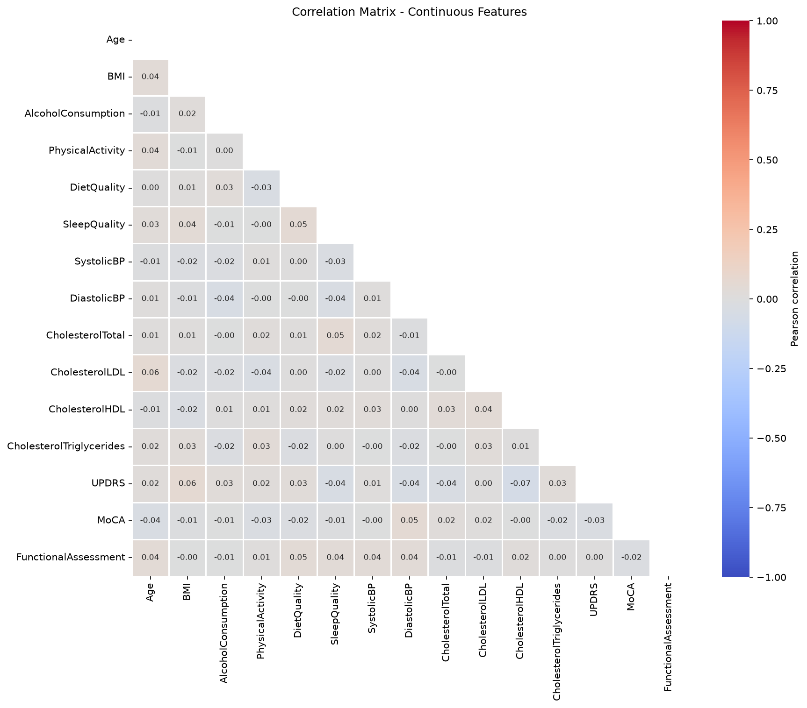
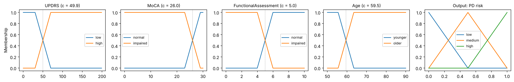

```{=html}
<!--
HOW THIS FILE MAPS TO THE ASSIGNMENT:
- 7 sections below, matching the 7 required sections exactly (not split/merged like A1 was).
- Max length: 7 A4 pages, EXCLUDING tables and figures. The brief does NOT say references or
  a technology statement are excluded here (that was an Assignment 1 rule) -- check this with
  the course before assuming the same applies, Report/README.md has more on this.
- Every figure/table is wrapped in the FIGURE/TABLE start/end markers (see README).
```

# Problem Framing & EDA

The target is `Diagnosis`, with Parkinson's disease (PD, 1) as the positive class and Non-PD (0) as the negative class. A proposed use is a screening/triage aid that flags patients for clinical review, assuming the required measurements are available at that point. A false negative could delay further assessment; a false positive could lead to unnecessary follow-up. For this proposed workflow, missed PD cases are given greater weight. This is a modelling assumption, not an established clinical cost estimate or a validated use case.

Recall measures the proportion of PD cases detected, while precision and specificity describe unnecessary positive flags and correct Non-PD classification. The confusion matrix makes both error types explicit. F2 weights recall more heavily than precision and is the planned validation-based threshold-selection criterion. Accuracy alone would obscure these trade-offs and the unequal class proportions.

After excluding `PatientID` and `DoctorInCharge`, the dataset contains 2,105 rows and 32 predictors. A stratified 80/20 split with `random_state=42` allocates 1,684 rows to training/validation and reserves 421 for final testing. The class balance below and the feature comparisons use training/validation data.

<!-- TABLE:start -->

| Training/validation class | Patients |  Share |
|:--------------------------|---------:|-------:|
| PD (1)                    |    1,043 |  61.9% |
| Non-PD (0)                |      641 |  38.1% |
| Total                     |    1,684 | 100.0% |

<!-- TABLE:end -->

No missing predictor values were found in training/validation data. The class-specific boxplots (@fig-boxplots) show no visible outliers beyond the 1.5 × IQR whiskers; this does not establish clinical validity of the values. UPDRS, FunctionalAssessment and MoCA show the clearest distributional differences, although the classes still overlap. Their point-biserial correlations with `Diagnosis` are 0.402, -0.219 and -0.165, respectively. All other continuous predictors have \|r\| ≤ 0.070. Pairwise Pearson correlations among continuous predictors are also weak, approximately -0.07 to 0.06 (@fig-correlations). These are descriptive associations, not evidence of causality or final predictive performance.

<!-- FIGURE:start -->

{#fig-boxplots fig-pos="H"}

{#fig-correlations fig-pos="H"}

<!-- FIGURE:end -->

# Preprocessing & Feature Engineering

All 32 predictors are retained for SVM and MLP. No constant features were found; `Stroke` has the lowest variation, with 95.0% of training/validation observations sharing one value. This alone does not establish that it lacks predictive information. Weak individual target correlations also do not rule out non-linear relationships or interactions. No imputation, outlier removal, resampling or additional engineered features are applied in the defined preprocessing.

A `ColumnTransformer` standardises 15 continuous predictors with `StandardScaler`, one-hot encodes `Ethnicity` and `EducationLevel` to avoid assuming numerical distances between categories, and passes 15 binary predictors through unchanged as 0/1 values. Standardisation addresses the different numerical scales for SVM and MLP. Both classifiers include this transformer in a `Pipeline`, so fitting through cross-validation learns transformations separately within each training fold. The notebook defines this setup; completed tuning results are not yet available.

The FIS uses separate preprocessing. Its draft input list contains UPDRS, MoCA, FunctionalAssessment, Age and SleepQuality, with the first three supported most clearly by the EDA. The code derives input minima and maxima from `X_trainval` in their original units; membership functions and rules remain unfinished. For validation, any data-dependent ranges or membership parameters must instead be derived from the relevant training fold or split and applied unchanged to its validation data. Full `X_trainval` may be used for the final fit after model selection, without using test data.

One limitation remains: the notebook's initial missing-value, duplicate and descriptive-statistics cell uses the full `df`, including the reserved test rows. Its zero-duplicate result therefore describes the full dataset. These development checks should be restricted to training/validation data before claiming complete test-set isolation; a separate training/validation check already confirms zero missing predictor values.

# Models

**SVM.** Linear and RBF kernels are treated as candidate configurations of one SVM family [@cortes1995] and searched in a single grid (Section 4). Each SVC sits in a `Pipeline` behind the Section 2 preprocessor. It is wrapped in `CalibratedClassifierCV(method="sigmoid", ensemble=False)`: Platt scaling [@platt1999], fitted on an internal 5-fold split of the training data. This replaces `SVC(probability=True)`, which is deprecated from scikit-learn 1.9 [@pedregosa2011]. The sigmoid is monotone in the SVM decision value. It therefore leaves the ranking of patients unchanged and only puts the scores on the [0, 1] scale used by the threshold rule in Section 5.

**MLP.** `MLPClassifier` with ReLU hidden layers, Adam (learning rate 0.001) and up to 2,000 iterations, in the same pipeline. Early stopping is switched off so that the L2 penalty `alpha` is the only regulariser and its effect can be read directly from the validation results. A fixed seed makes the weight initialisation reproducible.

**FIS.** A Mamdani system [@mamdani1975] built with scikit-fuzzy [@warner2024] and wrapped as a scikit-learn estimator. It is therefore validated on the same folds and exposes the same `predict_proba` interface as SVM and MLP. It uses four continuous inputs (@tbl-fis-inputs). SleepQuality, proposed in the first draft, was dropped: its PD rate is flat across training-set quintiles (0.59 to 0.66), and the PD literature concerns sleep *disorders*, a binary column.

<!-- TABLE:start -->

| Input | Source | Translated into |
|:---|:---|:---|
| UPDRS | Attribute description: higher = more severe; MDS-UPDRS is the standard PD rating scale [@goetz2008] | Higher is abnormal; universe 0–199 |
| MoCA | Attribute description: lower = cognitive impairment; published cut-off $<$ 26 [@nasreddine2005] | Lower is abnormal; crossover fixed at 26; universe 0–30 |
| FunctionalAssessment | Attribute description: lower = greater impairment | Lower is abnormal; universe 0–10 |
| Age | PD prevalence rises from 107 to 428 per 100,000 between ages 50–59 and 60–69 [@pringsheim2014] | Higher is abnormal; source crossover 60; universe 50–90 |

: FIS inputs and their source-to-model translation. {#tbl-fis-inputs}

<!-- TABLE:end -->

Each input has two membership functions, a "normal" and an "abnormal" set, built as complementary trapezoids around a crossover point *c* with transition half-width *h* (@fig-fis-mf). Two sets were chosen over three because the EDA shows a step-like change in PD rate for each clinical score: for example, the PD rate is 0.31 for MoCA $\geq$ 26 and 0.66 below it. The sources fix the direction of each input and, for MoCA, the crossover. The other crossovers are the only data-dependent preprocessing. They are either taken from the sources (scale midpoints where no source gives a value) or learned from the training rows of each fold with a depth-1 decision tree per input (Section 4).

<!-- TABLE:start -->

| Rule | IF | THEN | Rationale |
|:---|:---|:---|:---|
| R1 | UPDRS high AND MoCA impaired AND FA impaired | high | Motor severity plus both cognitive and functional impairment |
| R2 | UPDRS high AND (MoCA impaired OR FA impaired) | medium | Motor severity with one supporting impairment |
| R3 | UPDRS high AND Age older | medium | Age as main epidemiological risk factor [@pringsheim2014] |
| R4 | UPDRS low AND MoCA impaired AND FA impaired | medium | Impairment without motor severity |
| R5 | UPDRS low AND MoCA normal | low | No motor severity, normal cognition |
| R6 | UPDRS low AND FA normal | low | No motor severity, normal function |
| R7 | MoCA normal AND FA normal | low | No cognitive or functional impairment |

: FIS rule base. {#tbl-fis-rules}

<!-- TABLE:end -->

The seven rules (@tbl-fis-rules) put UPDRS first, because it is the only input that measures PD-specific motor severity, and treat MoCA, FA and age as supporting evidence. AND is the minimum, OR the maximum, implication clips the output set, and the clipped sets are aggregated by maximum. The output has three triangular sets on [0, 1] and is defuzzified by centroid. Because the centroid of these sets can only lie in [1/6, 5/6], it is rescaled linearly to [0, 1]; this mapping depends on the output sets only, not on data. Since UPDRS low and high always sum to one and the rules condition on both, at least one rule fires for every patient. On 200 training rows, the vectorised implementation matches scikit-fuzzy's control API to within $7 \times 10^{-5}$.

<!-- FIGURE:start -->

{#fig-fis-mf}

<!-- FIGURE:end -->

# Validation & Hyperparameter Optimization

All model development uses the 1,684 training/validation rows only. Every model is evaluated on the same stratified 5-fold split (`shuffle=True`, `random_state=42`), so the scores are directly comparable. Each validation fold keeps the 62/38 class ratio and has about 128 Non-PD patients. All data-dependent steps (scaling, encoding, FIS crossovers, Platt sigmoid) are refitted within each training fold.

The selection criterion is average precision (AP), with recall, F2 and ROC AUC logged as secondary metrics. The decision threshold is fixed later by maximising F2 (Section 5), so selection should reward a good ranking of patients rather than predictions at the default 0.5 cut-off. Selecting on recall at 0.5, as in the first draft, rewards models that flag almost everyone: in our SVM grid, the five RBF configurations with $\gamma$ = 0.5 have the highest recall (0.911 to 0.914) and the lowest AP (0.796 to 0.797).

Each grid was fixed in advance and run once. The SVM family has 20 configurations: linear with C $\in$ {0.001, 0.01, 0.1, 1, 10} and RBF with C $\in$ {0.1, 1, 10, 100, 1000} $\times$ $\gamma \in$ {0.005, 0.05, 0.5}. The $\gamma$ values are 0.1, 1 and 10 times scikit-learn's `scale` heuristic (0.051 on the preprocessed training data). The MLP has 20 configurations: hidden layers {(8), (32), (64), (32, 16)} $\times$ $\alpha \in$ {0.001, 0.01, 0.1, 1, 10}, log-spaced to cover both weak and strong regularisation. For the FIS, the inputs, membership-function count and rules were fixed by the sources. Two design choices remained, and their four combinations were compared on the same folds and criterion: crossovers from the sources or learned per training fold, and half-width *h* of 2.5% or 10% of each universe.

<!-- TABLE:start -->

| Model | Selected configuration | CV AP (± SD) | CV ROC AUC | Train AP |
|:---|:---|---:|---:|---:|
| SVM (RBF), selected | C = 10, $\gamma$ = 0.005 | 0.937 ± 0.017 | 0.907 | 0.956 |
| SVM (linear), best | C = 10 | 0.932 ± 0.014 | 0.896 | 0.939 |
| MLP | one layer, 32 units, $\alpha$ = 1 | 0.946 ± 0.014 | 0.920 | 0.988 |
| FIS | learned crossovers, *h* = 10% | 0.866 ± 0.015 | 0.813 | 0.866 |

: Best configuration per model (5-fold CV search scores on training/validation data; not final test performance). {#tbl-hpo}

<!-- TABLE:end -->

@tbl-hpo summarises the results; all 44 configurations are in `Report/tables/hpo_all_configurations.csv`. The RBF SVM adds little over the linear kernel (0.937 vs 0.932, less than one fold SD). $\gamma$ = 0.5 overfits at every C, with train AP 1.000 against CV AP 0.80. The selected $\gamma$ is the smallest value in the grid, so a smoother kernel might do slightly better, but the budget did not allow widening the grid after seeing the results. For the MLP, $\alpha \leq 0.1$ gives train AP $\approx$ 1.000 with CV AP of 0.91–0.93 for every architecture (high variance). $\alpha$ = 10 lowers both to about 0.93 and 0.92 (high bias), and $\alpha$ = 1 is best for all single-layer networks. For the FIS, crossovers learned on the training folds beat the source and midpoint values (0.866 vs 0.842). This comes mainly from UPDRS, whose learned crossover (49.9) is far from the scale midpoint (99.5). The learned FA and Age crossovers (4.99 and 59.5) land close to the midpoint and the literature value.

These CV scores are search scores. Taking the maximum over 20 noisy estimates is optimistically biased [@cawley2010], and the FIS rule structure was designed after inspecting the training/validation EDA. The test set was not used for any of these choices. The frozen-threshold test evaluation in Section 5 provides the unbiased performance estimate.

# Model Selection & Thresholding

```{=html}
<!-- TODO: explain how validation predictions/scores were obtained (held-out validation split
or out-of-fold), confirm the same rule (maximize F2 on validation) was applied to all three
models, report the resulting threshold per model, and state clearly that thresholds were
frozen before looking at the test set. -->
```

<!-- TABLE:start -->

```{=html}
<!-- TODO: per-model frozen-threshold test results -- confusion matrix, recall, precision,
specificity, F2 -->
```

<!-- TABLE:end -->

<!-- TODO: compare the three models' test performance and discuss differences. -->

# Decision Support & Practical Value

```{=html}
<!-- TODO: recommended model and justification from the results above; who uses the output and
what decision/action it supports; the proposed decision policy connecting score to action;
cost implications of false positives/negatives in this workflow; the assumptions behind the
value argument (remember: synthetic data, not clinically validated). -->
```

# Reflection

```{=html}
<!-- TODO: what worked best and why (bias-variance, linearity, model capacity, regularization,
training data volume); challenges encountered and how they were addressed; main limitations
and concrete future improvements. -->
```

# References

```{=html}
<!-- TODO: cite scikit-learn, your FIS library, and any literature referenced for the FIS
input choices or metric/threshold discussion. references.bib already exists in this folder
from Assignment 1, add your new entries there. -->
```