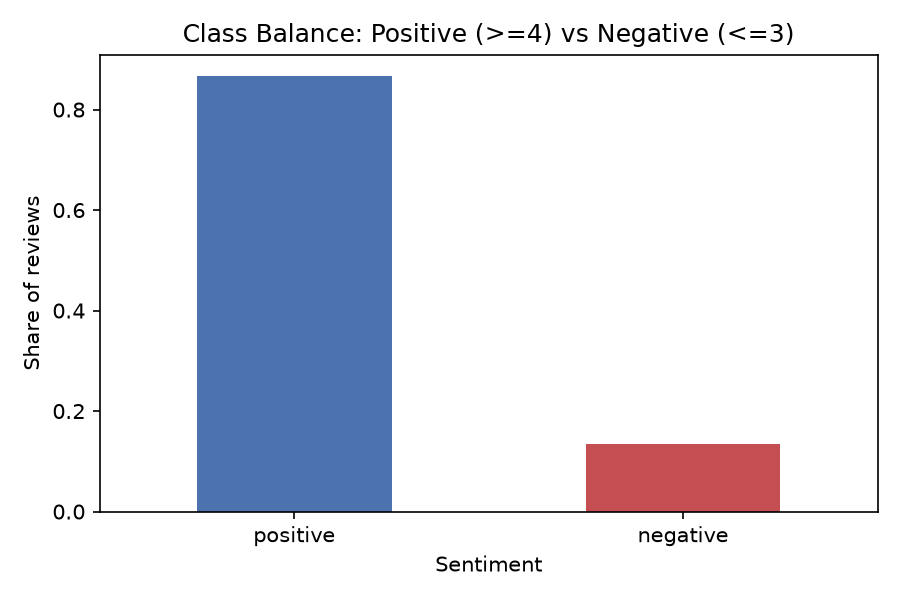
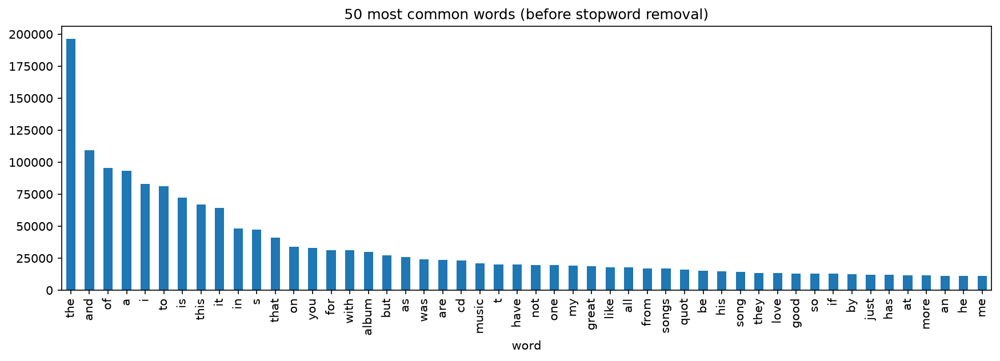
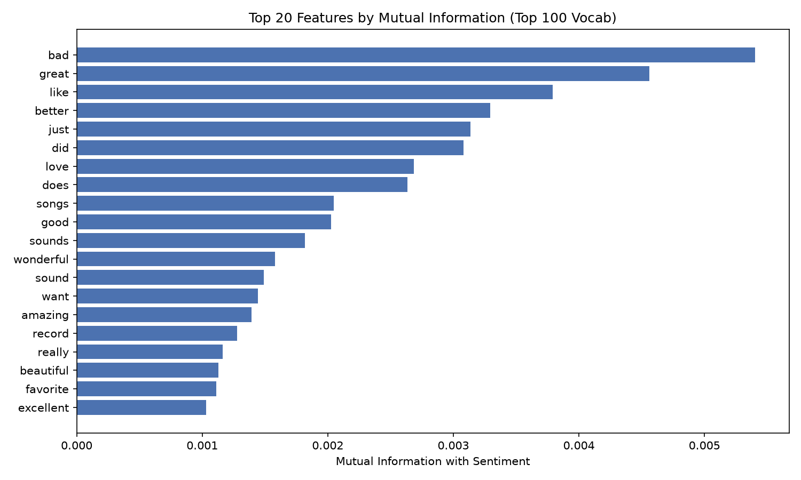
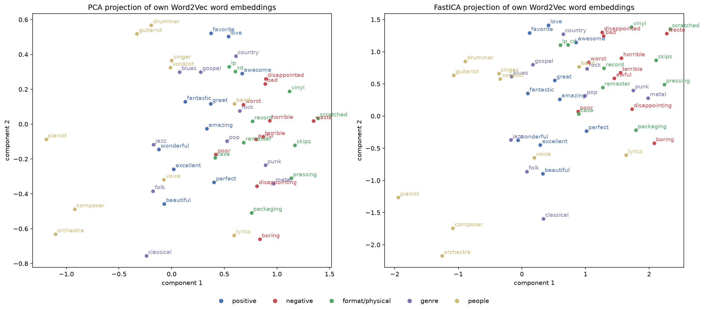
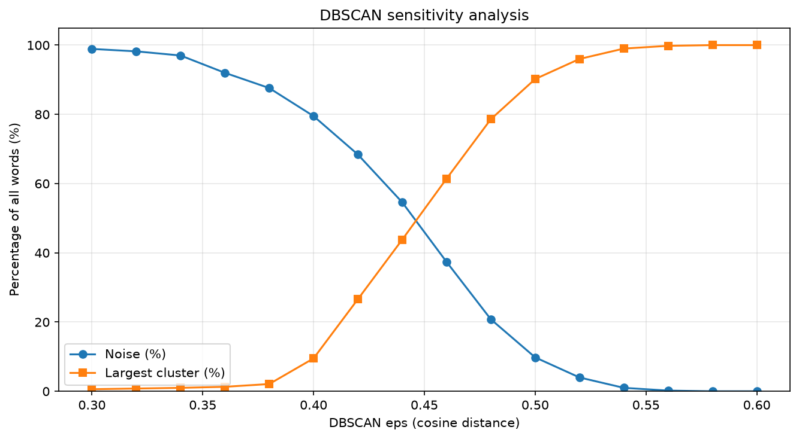

# Dataset Creation

Customer sentiment serves as a key indicator of product quality, pressing standards, and overall listener experience. However, manually analyzing thousands of reviews is not scalable, making machine learning a valuable tool for automating sentiment detection and uncovering underlying themes. In this project, we analyze the Amazon CDs & Vinyl dataset to classify customer opinions into binary sentiment labels and uncover major thematic patterns.

The Amazon CDs & Vinyl dataset includes numerical ratings (1–5) and corresponding textual reviews. To formulate this as a binary sentiment classification task, ratings of 4 and 5 are labeled as positive (1), while ratings of 3 and below are labeled as negative (0). The primary objective is to predict sentiment labels strictly based on the textual content of each review [@hou2024].

The raw dataset initially contained 50,000 observations. Following the removal of 2,803 duplicate records, the initial deduplicated corpus comprised 47,197 reviews. The dataset displays a distribution notably skewed toward positive feedback: 86.63% of entries correspond to positive ratings (1), while only 13.37% correspond to negative ratings (0), as illustrated in @fig-class-balance.

<!-- FIGURE:start -->

{#fig-class-balance width="50%"}

<!-- FIGURE:end -->

# Preprocessing

Each review is processed to standardize text and eliminate lexical noise. Characters are converted to lowercase, and all HTML tags, line breaks, punctuation, digits, special characters, and bracketed text are stripped before tokenization.

Regarding whether all reviews should be included in the analysis, non-informative entries must be pruned to avoid introducing noise and unrepresentative sparse vectors into downstream models:

- **Missing and empty text:** Reviews lacking text content provide no predictive signal and cannot be converted into meaningful representations; 6 empty reviews were dropped.

- **Punctuation and emoji-only entries:** Text containing exclusively non-alphanumeric symbols provides no valid vocabulary tokens post-cleaning; 34 such reviews were removed.

- **Extremely short reviews:** While 2,039 reviews contained $\le 2$ words, reviews with at least one informative token were retained, resulting in a final clean dataset of 47,163 reviews retained out of 47,197.

# Analysis

Descriptive statistics were computed across the retained tokenized corpus prior to stopword filtering to assess review lengths and vocabulary dispersion.

<!-- TABLE:start -->

|  |  |  |
|------------------------|------------------------|------------------------|
| **Number of reviews** | **Average words per review** | **Number of unique words** |
| 47,163 | 81.00 | 70,094 |

: Descriptive statistics of the preprocessed corpus.

<!-- TABLE:end -->

The corpus contains 47,163 observations with an average of 81.00 words per review and a rich vocabulary of 70,094 unique words. A word cloud was generated to visualize the most frequently occurring terms, confirming domain relevance and identifying potential sources of syntactic noise, as shown in @fig-top50-words.

<!-- FIGURE:start -->

{#fig-top50-words}

<!-- FIGURE:end -->

Prior to stopword removal, the most prominent tokens consist of syntactic filler words (e.g., *"the"*, *"and"*, *"a"*, *"of"*, *"to"*) alongside core domain terms (e.g., *"album"*, *"song"*, *"cd"*, *"sound"*, *"track"*, *"music"*) and evaluative sentiment cues (*"great"*, *"good"*, *"love"*, *"best"*).

# Feature Representation

The first text representation technique applied was the Bag-of-Words (BoW) model. This approach converts each review into a numerical vector based on word frequency. Although this approach disregards grammar and word order, it captures overall word occurrence patterns, providing a simple and effective baseline for text-based sentiment classification.

Stopwords were removed using scikit-learn's built-in English stopword list. After stopword removal, the 100 most common words concentrate heavily on musical content (*"album"*, *"song"*, *"sound"*, *"tracks"*, *"band"*, *"record"*) and sentiment evaluators (*"great"*, *"love"*, *"good"*, *"bad"*, *"best"*).

To measure feature discriminability, Mutual Information was calculated between these 100 words and the target sentiment label. The top 20 most informative words are shown in @fig-mutual-info.

<!-- FIGURE:start -->

{#fig-mutual-info width="80%"}

<!-- FIGURE:end -->

The mutual information analysis reveals that explicit sentiment adjectives (*"great"*, *"bad"*, *"love"*, *"like"*, *"better"*, *"good"*) carry the highest information gain for separating positive from negative listener ratings. Specifically, *"bad"* exhibits the highest mutual information score (\~0.0054), followed by *"great"* (\~0.0046) and *"like"* (\~0.0038). In contrast, neutral musical nouns (*"record"*, *"sound"*, *"songs"*) have substantially lower mutual information scores despite their high frequencies.

**TF-IDF baseline.** We represented each review by the TF-IDF weights of the 100 most frequent non-stopwords and trained a Logistic Regression on a stratified 80/20 train/test split (37,730 / 9,433 reviews; IDF and all models fitted on the training part only). With default class weights, the model achieves 86.6% accuracy, but this largely reflects the dominance of positive reviews. Negative recall is only 5.7% (macro F1 0.515, balanced accuracy 0.524). Applying `class_weight="balanced"` increases negative recall to 75.6% and balanced accuracy to 0.687, at the cost of more false positives for the negative class (negative precision 0.234, accuracy 0.636) [@salton1988].

The coefficients are interpretable: generic praise words (*amazing, great, wonderful*) push towards positive, *bad* towards negative. Notably, *did* and *does* are among the strongest negative features: they are the remains of *didn't/doesn't* once "not" is removed as a stopword, so negation is learned indirectly. Product words (*record, disc, sounds*) are also negative, because complaints often concern the physical product rather than the music.

<!-- TABLE:start -->

| Model (test set) | Accuracy | Balanced acc. | Macro F1 | Neg. precision | Neg. recall |
|------------|------------|------------|------------|------------|------------|
| TF-IDF top-100 + LR | 0.866 | 0.524 | 0.515 | 0.503 | 0.057 |
| TF-IDF top-100 + LR, balanced | 0.636 | 0.687 | 0.552 | 0.234 | 0.756 |

: TF-IDF + Logistic Regression on the held-out test set.

<!-- TABLE:end -->

**Word2Vec: own vs. pretrained.** We trained our own skip-gram Word2Vec (100 dimensions, window 5, `min_count` 5, 10 epochs) on the training reviews *with* stopwords, so that negations and local context are kept, and compared it with the pretrained `word2vec-google-news-300` model [@mikolov2013] (@tbl-w2v). The pretrained model is trained on about 100B words and therefore gives stable vectors even for rare words, and it covers more of our vocabulary (99.0% of running words, after a case-insensitive lookup, since it is case-sensitive). However, it encodes the *general* meaning of words: its neighbours of *pressing* are *pushing* and *urgent*, and of *skips* are *avoids* and *cancels*. Our custom-trained model learns the domain meaning (*pressing* → vinyl, defect, reissue; *skips* → scratches, defect), is three times smaller, and still covers 97.6% of running words; its weakness is that the small corpus leaves rare words (mostly artist names) out or poorly estimated. In a 5-fold stratified cross-validation on the training set, a balanced Logistic Regression scores a macro F1 of 0.696 on pretrained and 0.688 on own embeddings. We prefer **our custom model**: the gap is small (about 1.5 standard deviations), and the custom model captures the product-related meanings that drive complaints, is far lighter to deploy (the pretrained table would add about 600 MB to the saved model), and is the model we analyse in the following sections.

<!-- TABLE:start -->

::: {#tbl-w2v}
|   | Own (CDs & Vinyl) | Pretrained (Google News) |
|------------------------|------------------------|------------------------|
| Vocabulary, dimensions | 18,466 words, 100 | 3M words (500k loaded), 300 |
| Coverage of running words | 97.6% | 99.0% |
| Neighbours of *pressing* | vinyl, defect, equipment | pressed, pushing, vexing |
| Neighbours of *skips* | skipped, scratches, skipping | skipped, skipping, misses |
| CV macro F1, mean pooling | 0.688 ± 0.006 | 0.696 ± 0.003 |
| CV macro F1, IDF-weighted | 0.683 ± 0.004 | 0.682 ± 0.003 |

: Comparison of the two Word2Vec models: 5-fold CV on the training set
:::

<!-- TABLE:end -->

**From word to document embeddings.** A review is represented by the average of the vectors of its words that the model knows (a zero vector if none). We also tested an IDF-weighted average, which was slightly worse for both models (@tbl-w2v): IDF up-weights rare words, whereas sentiment is mostly carried by frequent words such as *great*, *love* and *bad*. Averaging discards word order, so constructions like "good songs, terrible pressing" are only partly captured.

# Feature Selection and Dimensionality Reduction

We projected all 18,466 word vectors of our custom model to two dimensions with PCA and FastICA [@hyvarinen2000] and plotted 50 hand-picked words from five groups (@fig-pca-ica). Locally, some structure survives: near-synonyms such as *terrible/awful* and *scratched/skips* stay close (only 15 and 7 of the 2,000 most frequent words lie closer), rock-band roles (*drummer, guitarist, vocalist*) and classical terms (*orchestra, composer, pianist*) form two separate groups, and negative words lie on the same side as defect words (*scratched, skips, waste*), suggesting the first component separates complaints about the product from talk about the music. Globally, however, two dimensions are far too few. The two principal components explain only 13.4% of the variance and only 3% of each word's ten nearest neighbours are preserved. The five groups, clearly separated in the original space (cosine silhouette 0.27), overlap in 2D (silhouette -0.10). Some synonyms are pulled apart: *great* and *excellent* have cosine similarity 0.72, yet 926 words lie closer to *great* in the PCA plot. Positive and negative words are not cleanly separated either, which is expected because Word2Vec groups words used in similar contexts, and *great* and *terrible* occur in very similar ones.

PCA and ICA give the same picture, only mirrored and stretched, with identical neighbour preservation (3.1% vs. 3.2%). This follows from the fact that FastICA relies on PCA whitening as an initial step before optimizing for statistical independence via rotation; consequently, it cannot recover variance already discarded during the initial two-component projection. PCA is the more interpretable of the two here, because its axes are ordered by explained variance [@jolliffe2002; @hyvarinen2000].

<!-- FIGURE:start -->

{#fig-pca-ica width="100%"}

<!-- FIGURE:end -->

# Training Procedure

Three classifiers - KNN, GaussianNB, and Logistic Regression - were trained on Word2Vec document representations. Each review was represented by 100-dimensional vector, obtained by averaging the embeddings of its' known words using the custom-trained Word2Vec model.

The dataset was divided into stratified 80/20 train-test split, resulting in 37,770 training reviews and 9,433 test reviews with approximately 86.6% being positive reviews, making both datasets skewed and imbalanced. StandardScaler was included in the KNN and Logistic Regression pipelines to standardize the embedding features. GausianNB was used instead of Multinomial Naive Bayes, because Word2Vec embeddings can contain negative values. GaussianNB supports continuous-valued features and assumes that each feature follows a Gaussian distribution within each class, although this assumption may not fully hold for word embeddings.

To improve performance, GridSearchCV was applied to Logistic Regression using five-fold stratified cross-validation. Grid search was used over randomized search because the hyperparameter space was relatively small. Only four values of the regularization parameter ((C = 0.001, 0.1, 1, 10)) and two class-weighing options (None, balanced) were considered, resulting in just eight possible combinations. Grid search evaluates every combination using cross-validation, making it practical to compare all options systematically. Randomized search is more useful when the hyperparameter space is much larger, as it can reduce computation time by evaluating only a subset of possible combination. In this case, the evaluation of all eight cases was computationally feasible and ensured the best performing configuration within predefined search space.

The best configuration was achieved on regularization equal to 10 and balanced class weight, with a mean cross-validation macro F-1 score of 0.6883. When evaluated on the held-out test set, the tuned model achieved approximately 78% accuracy and a macro F-1 score of 0.68. It's negative-class recall increased to 82%, while positive-class recall decreased to 77%.

# Clustering and Topic Modeling

**Word embedding clustering.** We applied Agglomerative Clustering and DBSCAN to the 2,000 most frequent words from our own Word2Vec model, using cosine distance. DBSCAN (`eps=0.38`, `min_samples=10`) identified 13 clusters with a silhouette score of 0.260, excluding noise points. The clusters captured recognizable semantic groups, including music formats, positive evaluations, instruments, classical music, and purchasing experiences. However, 87.6% of words were classified as noise. The sensitivity analysis (@fig-DBSCAN_sensitivity_analysis) illustrates the trade-off: increasing `eps` reduces noise but causes the largest cluster to dominate, limiting meaningful separation. Agglomerative Clustering (average linkage, 13 clusters) assigned all words to clusters but achieved a silhouette score of only 0.017, with several large, semantically mixed clusters. Thus, DBSCAN identified more coherent local groups, whereas Agglomerative Clustering provided broader but less distinct coverage [@ester1996].

<!-- FIGURE:start -->

{#fig-DBSCAN_sensitivity_analysis}

<!-- FIGURE:end -->

**Topic modeling.** BERTopic and FuzzyTM were applied to a reproducible sample of 10,000 training reviews. BERTopic used the selected 100-dimensional mean Word2Vec document embeddings. Its final configuration identified three topics, but assigned 99.03% of reviews to one generic music-related topic. FuzzyTM used ten topics and fuzzy c-means clustering. To limit memory consumption, terms occurring in fewer than 20 reviews were removed (`min_df=20`), terms occurring in more than 90% of reviews were excluded, and the vocabulary was capped at 1,500 words. After preprocessing, 9,896 documents remained [@grootendorst2022].

<!-- TABLE:start -->

::: {#tbl-topic-quality-metric}
| Topic quality metric | BERTopic | FuzzyTM |
|----------------------|----------|---------|
| Number of topics     | 3        | 10      |
| C_v coherence        | 0.6371   | 0.7294  |
| Topic diversity      | 0.9667   | 0.5700  |

: Topic quality metric for BERTopic and FuzzyTM.
:::

<!-- TABLE:end -->

**Evaluation.** FuzzyTM achieved higher C_v coherence (0.7294 versus 0.6371) and identified more interpretable topics, particularly around classical compositions, orchestral performances, and musical characteristics. BERTopic achieved higher topic diversity (0.9667 versus 0.5700), but its highly imbalanced topic distribution, with 99.03% of reviews assigned to one generic topic, limited its usefulness. FuzzyTM showed considerable overlap in generic review vocabulary. Overall, FuzzyTM provided more meaningful thematic differentiation for this dataset, although neither method produced consistently distinct topics.

# Evaluation

We evaluated KNN, Gaussian Naïve Bayes, and Logistic Regression using Word2Vec document embeddings. Stratified 5-fold cross-validation was used for model selection, with macro F1 as the primary metric to account for class imbalance. Final performance was assessed on the held-out test set.

<!-- TABLE:start -->

::: {#tbl-model-evaluation}
| Classifier | CV macro F1 | Test macro F1 | Balanced accuracy | Negative recall |
|---------------|--------------:|--------------:|--------------:|--------------:|
| KNN | 0.6223 | 0.6057 | 0.5817 | 0.181 |
| GaussianNB | 0.4251 | 0.4155 | 0.6155 | 0.852 |
| Logistic Regression | 0.6514 | 0.6329 | 0.6027 | 0.226 |
| Logistic Regression (tuned) | **0.6883** | ≈ 0.68 | ≈ 0.80 | ≈ 0.82 |

: Performance comparison of Word2Vec classifiers.
:::

<!-- TABLE:end -->

The tuned Logistic Regression achieved the highest test macro F1 (approximately 0.68), improving upon the untuned model (0.633). GaussianNB achieved the highest negative-class recall (0.852), but its substantially lower macro F1 indicates an unfavorable trade-off between the two classes. KNN performed moderately, while the untuned Logistic Regression showed limited sensitivity to negative reviews.

Compared with the balanced TF-IDF baseline (macro F1 = 0.552), the tuned Word2Vec model provided better overall classification performance. The difference between cross-validation and test performance was relatively small, suggesting reasonable generalization. However, the strong class imbalance remains an important consideration when interpreting these results.

# Discussion & Limitations

The results demonstrate that text representation and model selection substantially influence sentiment classification performance. The tuned Logistic Regression using Word2Vec document embeddings achieved the highest macro F1, outperforming the TF-IDF baseline. This suggests that distributed word representations can capture useful semantic information beyond the limited 100-word vocabulary. However, this comparison does not establish that Word2Vec is generally superior to TF-IDF.

Class imbalance remains a major limitation. The untuned Logistic Regression showed low negative-class recall, while GaussianNB identified more negative reviews at the expense of overall classification performance. This highlights the importance of evaluating macro F1 and class-specific recall rather than accuracy alone.

Dimensionality reduction revealed substantial information loss. Two PCA components explained only 13.4% of the variance and preserved approximately 3% of nearest-neighbour relationships, limiting the interpretability of the 2D projections.

For word embedding clustering, DBSCAN produced more coherent clusters than Agglomerative Clustering (silhouette 0.260 versus 0.017), but classified 87.6% of words as noise. Agglomerative Clustering covered all words but produced less distinct semantic groups. DBSCAN therefore offered better local coherence at the expense of coverage.

For topic modeling, FuzzyTM achieved higher topic coherence than BERTopic (0.729 versus 0.637) and identified more interpretable themes. Although BERTopic achieved greater topic diversity (0.967 versus 0.570), it assigned 99.03% of reviews to one generic topic. FuzzyTM was therefore more useful for thematic exploration, although overlapping vocabulary limited topic distinctiveness.

Further improvements could include testing larger TF-IDF vocabularies, contextual embeddings, alternative document pooling strategies, and decision-threshold optimization. Additional validation on other product categories would help assess generalizability.

# References

::: {#refs}
:::

# Technology Statement

During the preparation of this assignment, the group used **ChatGPT (GPT-6) & Claude (5.5-sonnet)** as a support tool to improve documentation quality, resolve technical coding issues, and enhance writing clarity. The tool was specifically applied to assist in:

- explaining and documenting the tasks necessary to perform for this assignment,

- refining the structure and clarity of written report sections, and

- providing feedback on code documentation and debugging of specific tasks.

All AI-assisted outputs were critically reviewed, verified, and edited by the group members, **Abdulhabir Karahanli, Kíra Kollár, Ewa Kurowska and Gilbert Laanen**, to ensure correctness, academic integrity, and compliance with the course’s AI-Index Level 4 guidelines.

ChatGPT & Claude were used strictly as a supportive assistants, not as a content generator. The final analyses, designs, and interpretations were produced, validated, and approved by the team. Consequently, the authors take full responsibility for the accuracy and originality of all content included in this report.
